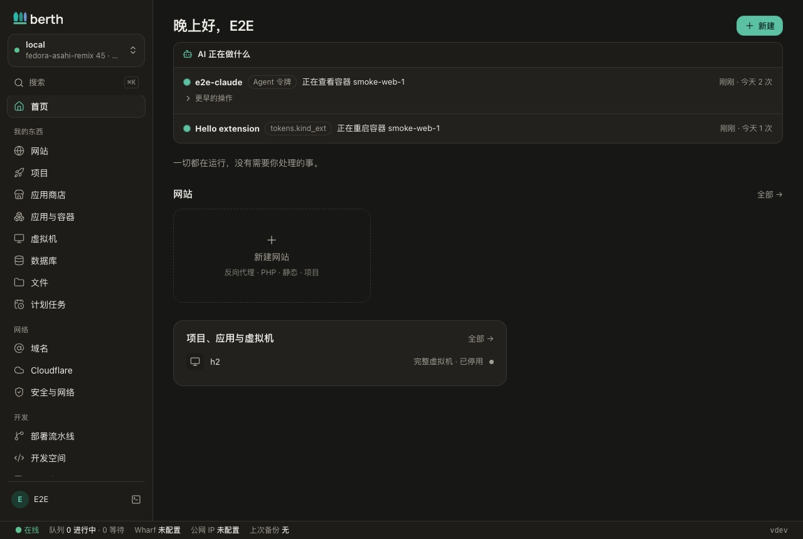
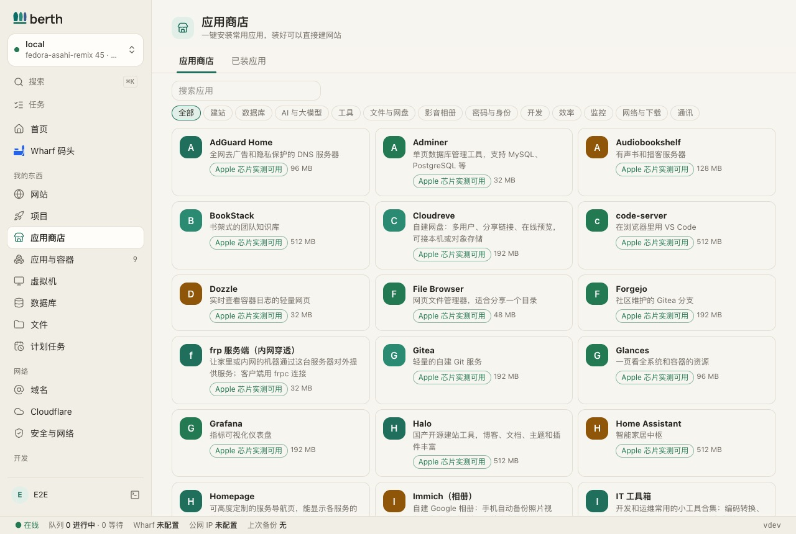
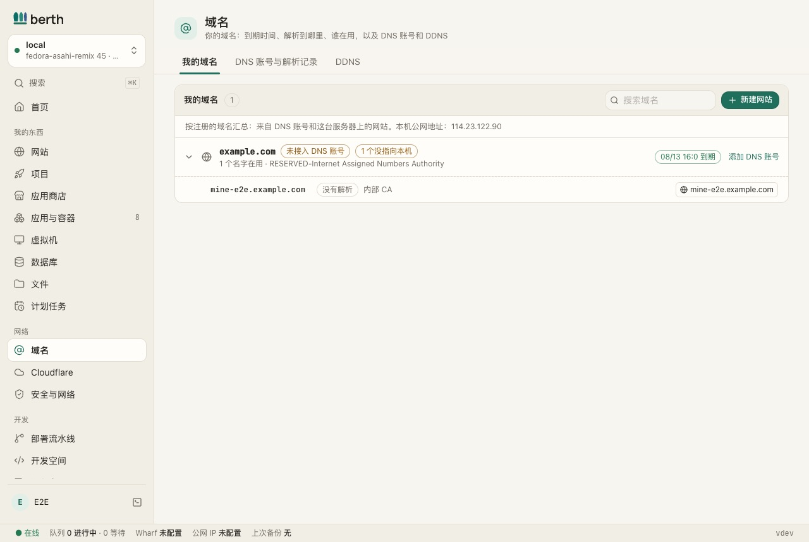
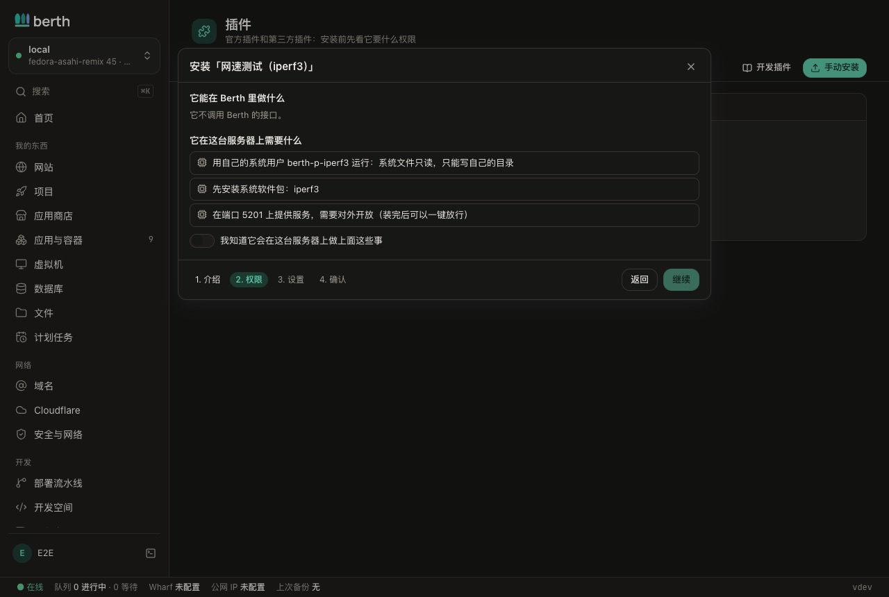
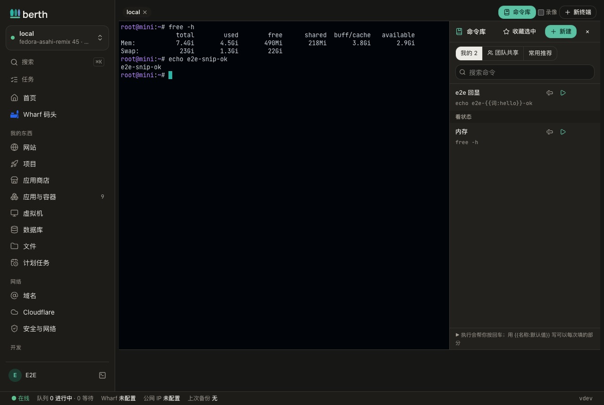
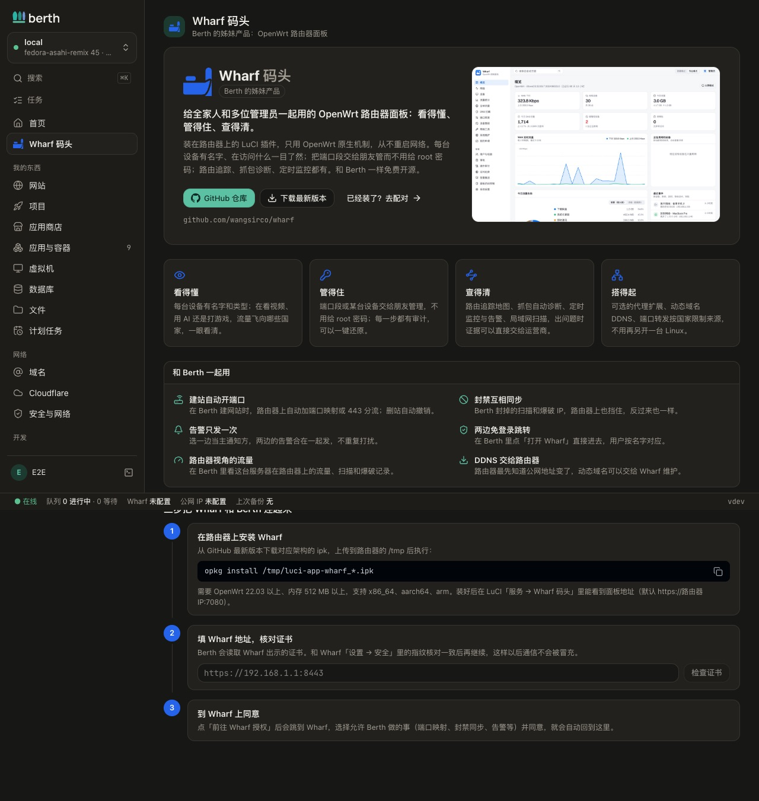

<p align="center">
  <picture>
    <source media="(prefers-color-scheme: dark)" srcset="docs/brand/berth-lockup-dark.svg">
    
  </picture>
</p>

<p align="center">
  <b>A Linux server panel that lets you almost forget about SSH.</b><br>
  Sites, native projects, containers, virtual machines, databases, backups and teams in one place — every change previewed, audited, and usually undoable.<br>
  <a href="README.md">简体中文</a> · English
</p>

<p align="center">
  <a href="https://github.com/wangsirco/berth/releases/latest"></a>
  <a href="LICENSE"></a>
  
  
</p>

---

## Why Berth

I am a heavy user of web panels for Linux servers. Over the years I have seriously used two of the best-known panels in mainland China and three of the best-known ones elsewhere. Each has its strengths, yet each felt one-sided, with one obvious gap:

- some are built for a single person and never thought about **multiple users** — who may see what, who may change what, who changed what;
- some manage only websites, some only containers; none brought **native programs, Docker containers and virtual machines** together, so one server needs several panels;
- with some, a few clicks in the browser still end with you back in **SSH** cleaning up;
- after a wrong setting, it is hard to tell what changed and harder to change it back.

So I set out to build a panel I would actually want to use every day. The ideas behind it are few:

1. **Really leave the command line.** Everything you do day to day can be done in the browser: sites, certificates, project deployments, apps, virtual machines, databases, backups and restores, moving a whole server, logs, a terminal. SSH stays for real emergencies only.
2. **Native, containers and VMs as equals.** PHP, Node, Python, Go and Java projects run natively or in containers; system containers and full VMs live in the same place, and a site can point to any of them.
3. **Safe for teams.** Super admins, admins and read-only members, each with their own permissions, hosts and folders; every change is audited — who, when, and whether from the web, the CLI or an AI.
4. **See before you change; go back if it was wrong.** Every write shows a preview first: files touched, commands run, risk. It is recorded, and most changes undo in one click. Changes that could lock you out — firewall, SSH, network — roll back by themselves unless confirmed within 60 seconds.
5. **Think one step ahead for people.** Creating a site checks its DNS; a failed deploy says which step failed and what to do; a finished migration lists the domains still pointing at the old server. A first-time user should get going fast, be pleasantly surprised, and find everything they need.
6. **Light, open, no lock-in.** About 30 MB of memory for panel and agent; no account to register, no data collected, no ads; remove the panel and your sites and containers keep running.

Berth is designed, built and tested together by its author and [Claude](https://www.anthropic.com/claude), Anthropic's AI — from the plans and the interface to every line of code and every test on real hardware.

## Screenshots

<table>
<tr><td width="50%"><br><sub>Home: what the AI assistant is doing, projects and apps at a glance</sub></td>
<td width="50%"><br><sub>App store: one-click installs, a site in another click</sub></td></tr>
<tr><td><br><sub>My domains: expiry, where each name points, what uses it</sub></td>
<td><br><sub>Plugin install wizard: every permission spelled out first</sub></td></tr>
<tr><td><br><sub>Web terminal with a command library</sub></td>
<td><br><sub>Works with its sister product Wharf, an OpenWrt router panel</sub></td></tr>
</table>

## Features

| | |
|---|---|
| **Sites** | Reverse proxy, PHP (several versions, one sandbox per site), static sites, native projects; automatic HTTPS (Let's Encrypt / ZeroSSL / DNS challenge / internal CA / uploaded); access rules, rate limits, hotlink protection, WAF (Coraza + OWASP CRS, optional); visitor stats; friendly default error pages |
| **Projects** | Node, Python, Go, Java and PHP run natively: built from Git or a folder into releases, switched only once healthy, one-click rollback, deploy on push |
| **Containers & app store** | Docker / Compose, update checks, resource limits; dozens of one-click apps; handling for Apple silicon's 16K memory pages |
| **Virtual machines** | Incus system containers and KVM VMs: snapshots, clones, resizing; three networks (share this server's address / own LAN address / none) with an outbound firewall; shared folders; Proxmox VE |
| **Databases** | MySQL / MariaDB / PostgreSQL / Redis, native or containerized, tuned to the machine; browse tables, import / export, slow queries, remote access |
| **Domains** | My domains (expiry reminders, DNS checks, point here in one click), DNS accounts and records (Cloudflare, Alibaba Cloud, DNSPod), DDNS, Cloudflare Tunnel and Access |
| **Backup & restore** | Encrypted, incremental restic backups to disk, S3, SFTP or cloud drives; monthly restore drills; restore from an upload; read another server's repository; move a whole server |
| **Security** | Firewall with 60-second automatic rollback, automatic bans, security entry, 2FA and passkeys, device management, virus scanning (optional) |
| **Teams & audit** | Super admin / admin / read-only, fine-grained permissions and host / folder scopes, quotas; every change audited and undoable, approvals for risky ones |
| **AI & automation** | Built-in MCP server so Claude and other AIs act through previews and approvals; the home page shows live what an AI is doing; API tokens and the `berth` CLI |
| **Everyday tools** | Files (with trash), web terminal (persistent sessions, recording), command library, remote desktop (RDP / VNC / SSH), scheduled tasks, monitoring and alerts (Telegram, ServerChan, WeCom, DingTalk, Feishu, …) |
| **Multiple hosts** | One panel, many servers, one agent each |
| **Plugins** | Third-party plugins in a sandboxed container or native, permissions confirmed one by one, optional signing; [plugin market & developer guide](https://github.com/wangsirco/berth-plugins) |
| **Online updates** | Signed updates; the UI updates without a restart, the program rolls back by itself if an update fails |

## Install

### One line

On the server, as root:

```bash
curl -fsSL https://raw.githubusercontent.com/wangsirco/berth/main/scripts/install.sh | sudo sh
```

The script does everything:

1. checks the system and architecture;
2. installs what is needed: Docker CE (from Docker's repository, with the Compose plugin), nftables, tc, smartmontools, acl, curl and certificates — plus a 4K-page compatibility layer (libkrun) on Apple silicon machines with 16K pages;
3. downloads the package and verifies its SHA-256;
4. creates the `berth` system user and folders, installs and starts the `berth-agent` and `berth-panel` services;
5. detects the public IP and **asks whether to open the panel to the internet**: usually yes on a cloud server (a security entry is set, the firewall opened and two-step sign-in required; remember to allow TCP 7090 in the provider's security group), no at home (LAN and Tailscale only, or a Cloudflare Tunnel later);
6. prints a setup link — open it within 10 minutes to create the super admin.

Run it again to upgrade in place; your data stays. Add `--ask` to confirm each step: `… | sudo sh -s -- --ask`; add `--public` or `--private` to skip the public-access question.

### Requirements

- **Architecture: ARM64.** Compatible with basically every ARM server: Apple M-series Macs, Raspberry Pi, ARM cloud servers (AWS Graviton, Oracle Ampere, Alibaba Yitian…). **x86 is on the way — stay tuned.**
- **System:** Fedora / Fedora Asahi Remix, Debian, Ubuntu, Rocky Linux, AlmaLinux, with systemd. **Tested so far on Fedora** (Fedora Asahi Remix on real hardware and a Fedora VM); the others should work, and issues are welcome.
- **Memory:** 1 GB or more; 4 GB or more for apps and VMs.
- **So far** Berth has been developed and tuned on **Apple M-series chips with Fedora Asahi Remix** — the combination we recommend and have tested most.

Optional parts, installed from the panel when you need them: Incus (VMs), restic / rclone (backups), several PHP versions, databases, WAF, ClamAV.

### After installing

- Open `https://<server IP>:7090`. The panel uses its own local certificate, so the browser warns the first time; compare the fingerprint printed at the end of the install.
- Turn on the **security entry** in Settings and **two-factor sign-in** for administrators.
- To reach the panel from outside later, pick a way under Settings → General → Access, or run `sudo berth admin public on` on the server.

### Forgot the security entry or the password

On the server:

```bash
sudo berth admin
```

A bilingual menu shows the panel's address and lets you change or turn off the security entry and change the administrator's username and password. Or use the subcommands:

```bash
sudo berth admin info                 # address, security entry, administrators
sudo berth admin entry /mypanel88     # change the security entry (off to turn it off)
sudo berth admin username newname     # rename the administrator
sudo berth admin password --random    # generate a new random password
sudo berth admin public on            # open public access (off to close)
```

### Upgrade and uninstall

- **Upgrade:** one click in Settings → Version & updates, or run the install command again.
- **Uninstall:** `sudo berth uninstall`. Sites, containers and data stay and keep running; `--purge` lists everything and, once you confirm, removes the sites, containers and panel data as well.

## Build from source

Go 1.27+ and Node.js 22+.

```bash
make build      # this machine
make cross      # linux/arm64
```

## More

- [Plugin developer guide](https://github.com/wangsirco/berth-plugins/blob/main/docs/PLUGIN-GUIDE.md)
- [Wharf](https://github.com/wangsirco/wharf), the sister product: an OpenWrt router panel for the whole family and several admins; paired with Berth it opens ports for your sites, shares bans and sends alerts once.

## Security

Please do not report security problems in public issues; use a private GitHub Security Advisory.

## License

[AGPL-3.0](LICENSE). Some code comes from Wharf (MIT); see [NOTICE](NOTICE).

## Thanks

Berth stands on the shoulders of many excellent open-source projects: Caddy, Docker, Incus, restic, rclone, Apache Guacamole, Coraza and the OWASP CRS, ClamAV, xterm.js, React and more.

And a special thank-you to two operating systems the author loves:

- **[Fedora](https://fedoraproject.org/)** — a Linux distribution that stays ahead and stays solid. Berth is developed and tested on it.
- **[Asahi Linux](https://asahilinux.org/)** — which brings full Linux to Apple M-series Macs. Berth's development machine is a Mac mini running Fedora Asahi Remix.

Thank you for turning a small Mac mini into a wonderful server.
