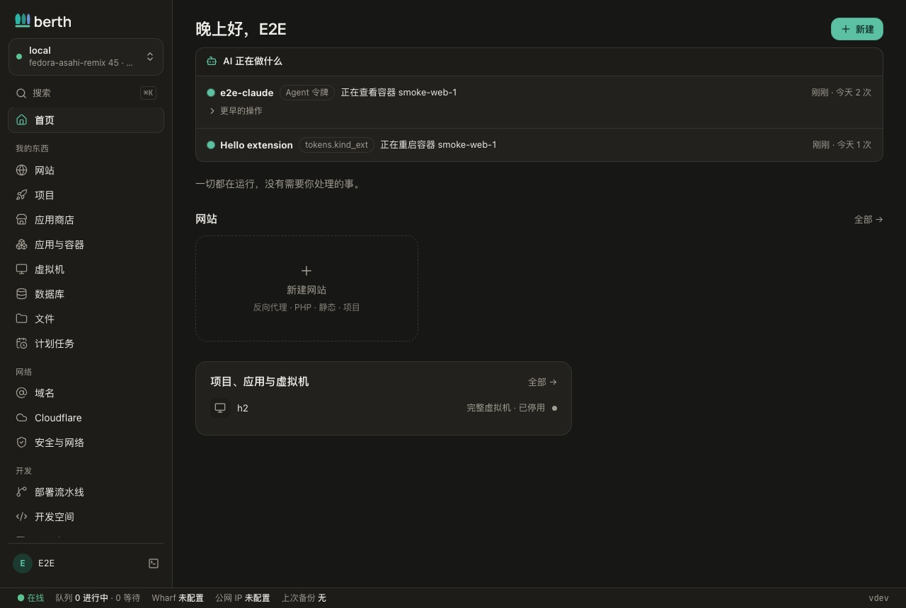
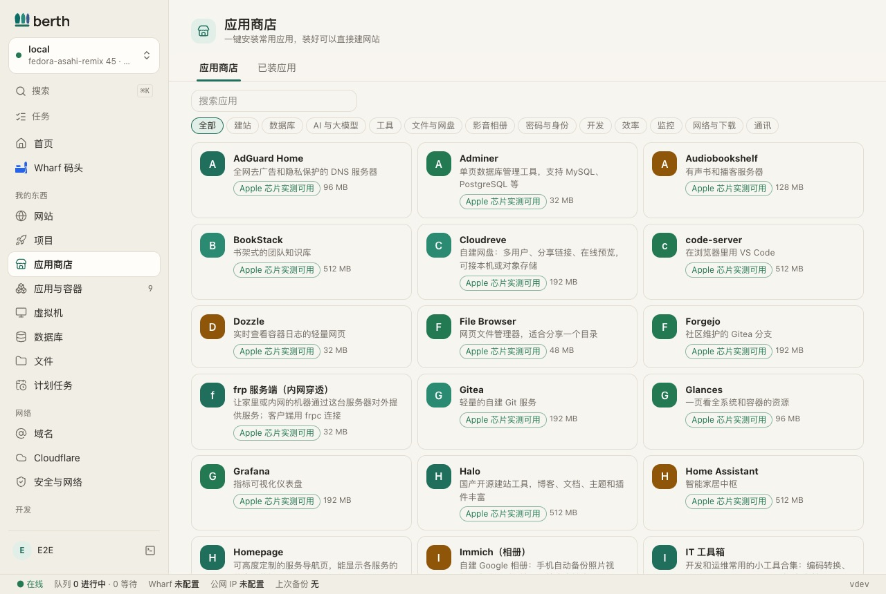
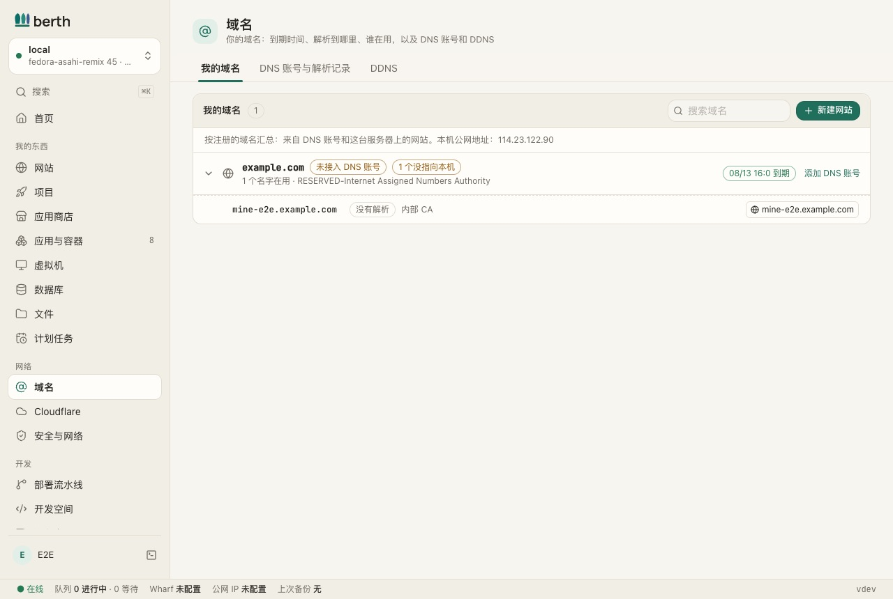
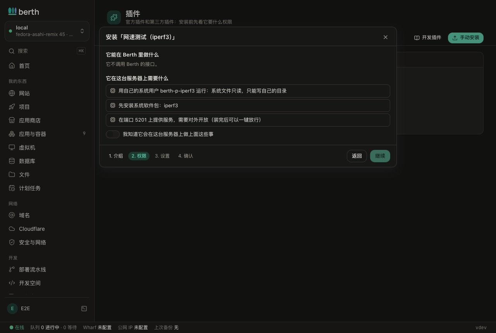
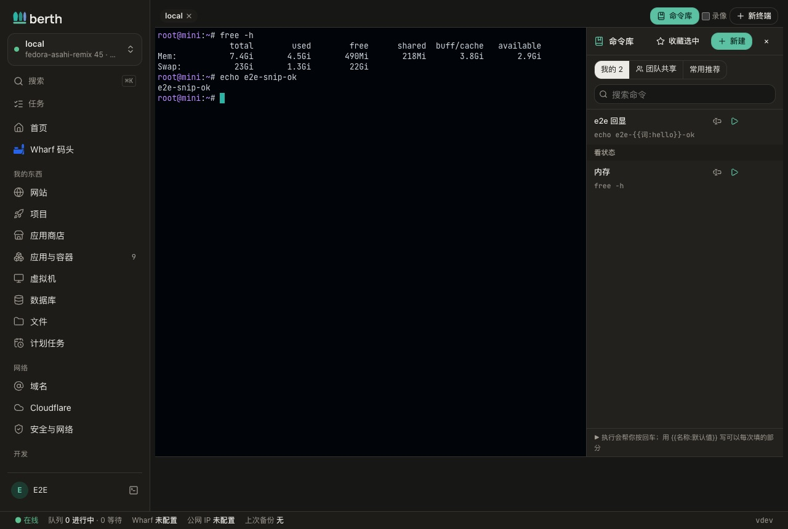
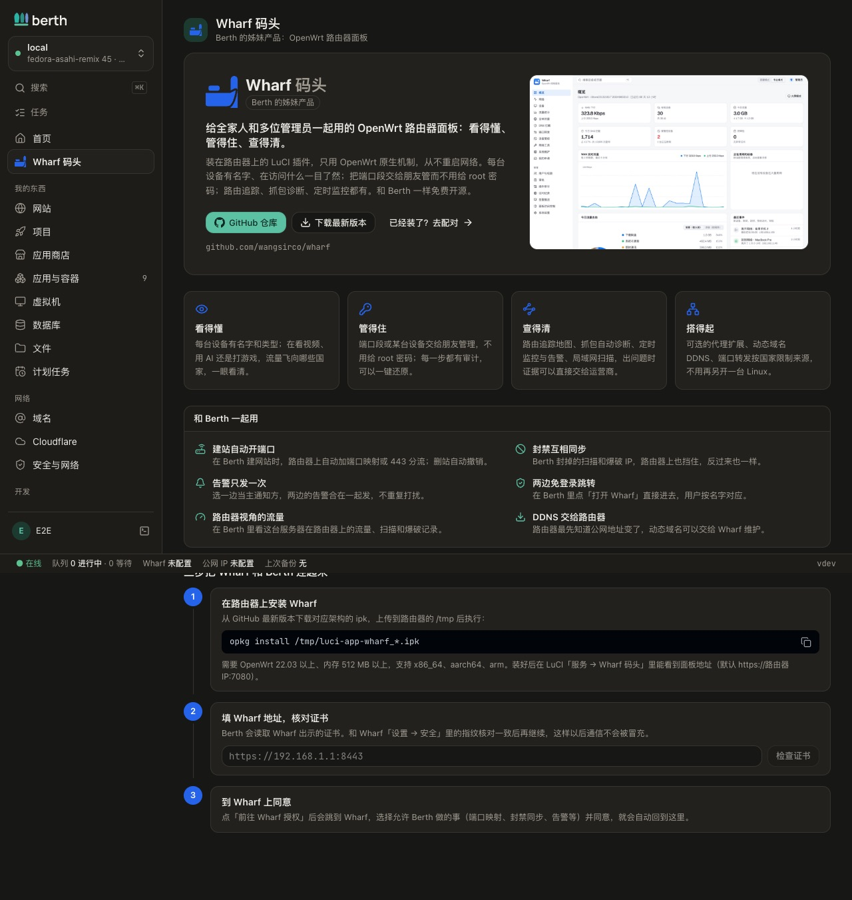

<p align="center">
  <picture>
    <source media="(prefers-color-scheme: dark)" srcset="docs/brand/berth-lockup-dark.svg">
    
  </picture>
</p>

<p align="center">
  <b>一个让你几乎不用再开 SSH 的 Linux 服务器面板。</b><br>
  网站、原生项目、容器、虚拟机、数据库、备份和多用户协作，一处管完；每次改动先预览、可审计、多数能撤销。<br>
  简体中文 · <a href="README.en.md">English</a>
</p>

<p align="center">
  <a href="https://github.com/wangsirco/berth/releases/latest"></a>
  <a href="LICENSE"></a>
  
  
</p>

---

## 为什么做 Berth

我是一个重度的 Linux 可视化面板用户。前前后后，我认真用过中国大陆两家比较知名的面板，也用过海外三家比较知名的面板。它们各有长处，但每一家都把产品做得有点片面，总有一块明显的短板：

- 有的只想到一个人用，没有考虑**多用户**：谁能看什么、谁能改什么、谁改了什么，都说不清；
- 有的只管网站，有的只管容器，没有把**原生程序、Docker 容器和虚拟机**放到一起管，结果一台服务器要开好几个面板；
- 有的界面上点几下，最后还是要回到 **SSH** 里敲命令收拾残局；
- 改错了一个配置，很难知道改了什么，更难改回去。

所以我想做一个自己真正愿意每天用的面板。它的初心只有几条：

1. **真正脱离命令行。** 日常要做的事，在网页上都能做完：建站、证书、部署项目、装应用、开虚拟机、管数据库、备份还原、整机迁移、看日志、开终端。SSH 只留给真正的意外。
2. **原生、容器、虚拟机一视同仁。** PHP、Node、Python、Go、Java 项目可以原生跑，也可以进容器；系统容器和完整虚拟机也在同一个地方，网站可以指向其中任何一个。
3. **多人一起用也安全。** 超级管理员、管理员、只读成员，每个人的权限、能管的主机和目录都能单独设置；每一次改动都记在审计里，写清楚是谁、在什么时候、从网页、命令行还是 AI 改的。
4. **改之前先看，改错了能退。** 每个写操作都会先给你看预览：要改哪些文件、执行什么命令、风险有多大。改完记入审计，多数一键撤销。改防火墙、SSH、网卡这类可能把自己锁在外面的操作，60 秒内不确认就自动恢复。
5. **替用户多想一步。** 新建网站时顺手检查域名解析，部署失败时告诉你哪一步错了、该怎么办，迁移完成后提醒你哪些域名还没指过来。我们希望第一次用的人也能快速上手，用起来有惊喜，觉得什么功能都有。
6. **轻、开放、不绑架。** 面板和 agent 常驻内存约 30 MB；不用注册账号，不收集数据，没有广告；卸掉面板，网站和容器照常运行。

Berth 由博主和 [Claude](https://www.anthropic.com/claude)（Anthropic 的 AI）共同设计、开发和测试：从方案、界面到每一行代码和每一次真机验收，都是我们俩一起完成的。

## 界面

<table>
<tr><td width="50%"><br><sub>首页：AI 助手正在做的事、项目和应用一目了然</sub></td>
<td width="50%"><br><sub>应用商店：一键安装，装好直接建站</sub></td></tr>
<tr><td><br><sub>我的域名：到期时间、解析到哪里、谁在用</sub></td>
<td><br><sub>插件安装向导：装之前看清它要的每一项权限</sub></td></tr>
<tr><td><br><sub>网页终端和命令库：常用命令一键执行</sub></td>
<td><br><sub>和姊妹产品 Wharf（OpenWrt 路由器面板）联动</sub></td></tr>
</table>

## 功能

| | |
|---|---|
| **网站** | 反向代理、PHP（多版本、每站独立沙盒）、静态站、原生项目；自动 HTTPS（Let's Encrypt / ZeroSSL / DNS 验证 / 内部 CA / 上传证书）；访问控制、限流、防盗链、WAF（Coraza + OWASP 规则，可选）；访问统计；出错时有友好的默认页 |
| **项目** | Node、Python、Go、Java、PHP 原生运行：从 Git 或目录构建，每次部署一个新版本，确认能访问才切换，一键回滚，推送自动部署 |
| **容器与应用商店** | Docker / Compose 管理、镜像更新检查、资源限制；应用商店一键安装几十个常用应用；Apple 芯片 16K 内存页的兼容处理 |
| **虚拟机** | Incus 系统容器和 KVM 虚拟机：快照、克隆、调整规格；三种网络（共享本机地址 / 局域网独立 IP / 不联网）和出站防火墙；共享文件夹；可接管 Proxmox VE |
| **数据库** | MySQL / MariaDB / PostgreSQL / Redis 原生或容器安装，按内存自动调优；网页查表、导入导出、慢查询、远程访问开关 |
| **域名** | 我的域名（注册到期提醒、解析检查、一键指向本机）、DNS 账号与解析记录（Cloudflare、阿里云、DNSPod）、DDNS、Cloudflare 隧道与 Access |
| **备份与还原** | restic 加密增量备份到本地、S3、SFTP、网盘；每月自动恢复演练；在线上传还原；读取其他服务器的备份仓库；整机迁移 |
| **安全** | 防火墙（改错 60 秒自动恢复）、自动封禁、安全入口、二步验证与 Passkey、登录设备管理、病毒扫描（可选） |
| **多用户与审计** | 超级管理员 / 管理员 / 只读成员，细分权限与主机、目录范围，配额；所有改动可审计、可撤销，高风险操作可要求审批 |
| **AI 与自动化** | 内置 MCP 服务器，Claude 等 AI 可以通过预览和审批安全地操作服务器；首页实时显示 AI 正在做什么；API 令牌、命令行 `berth` |
| **日常工具** | 文件管理（含回收站）、网页终端（会话保持、录像）、命令库、远程桌面（RDP / VNC / SSH）、计划任务、监控告警（Telegram、Server酱、企业微信、钉钉、飞书等） |
| **多主机** | 一个面板管理多台服务器，每台装一个 agent |
| **插件** | 第三方插件（容器沙盒或本地运行），安装前逐项确认权限，支持签名；[插件市场与开发指南](https://github.com/wangsirco/berth-plugins) |
| **在线更新** | 签名校验的在线更新，界面热更新不用重启，程序更新失败自动回滚 |

## 安装

### 一键安装

在服务器上用 root 运行：

```bash
curl -fsSL https://raw.githubusercontent.com/wangsirco/berth/main/scripts/install.sh | sudo sh
```

安装脚本全自动完成：

1. 检查系统和架构；
2. 安装需要的依赖：Docker CE（官方源，含 Compose 插件）、nftables、tc、smartmontools、acl、curl、证书；在 16K 内存页的 Apple 芯片机器上，还会装 4K 兼容层（libkrun）；
3. 下载安装包并校验 SHA-256；
4. 创建 `berth` 系统用户和目录，安装并启动 `berth-agent`、`berth-panel` 两个服务；
5. 检测公网 IP，并**问你要不要对公网开放面板**：云服务器一般选是（自动设置安全入口、放行防火墙，登录后必须开启二步验证；别忘了在云服务商的安全组里放行 TCP 7090）；家里的机器选否，只对局域网和 Tailscale 放行，以后也可以用 Cloudflare 隧道；
6. 打印初始化链接：10 分钟内打开它，创建超级管理员。

已经装过时再运行一次，就是就地升级，数据保留。想每一步先确认，在末尾加 `--ask`：`… | sudo sh -s -- --ask`；不想被问公网访问，可以直接加 `--public` 或 `--private`。

### 系统要求

- **架构：ARM64。** 基本兼容所有 ARM 服务器：Apple M 系列 Mac、树莓派、ARM 云服务器（如 AWS Graviton、Oracle Ampere、阿里云倚天等）都可以使用。**x86 版本正在开发中，敬请期待。**
- **系统：** Fedora / Fedora Asahi Remix、Debian、Ubuntu、Rocky Linux、AlmaLinux，需要 systemd。**目前在 Fedora 上实际测试过**（Fedora Asahi Remix 真机和 Fedora 虚拟机），其他发行版理论上可用，遇到问题欢迎提 Issue。
- **内存：** 1 GB 以上；要跑应用和虚拟机，建议 4 GB 以上。
- **说明：** 到目前为止，Berth 主要在 **Apple M 系列芯片 + Fedora Asahi Remix** 上开发和优化，这是我们最推荐、验证最充分的组合。

可选组件（需要时在面板里一键安装）：Incus（虚拟机）、restic / rclone（备份）、PHP 多版本、数据库、WAF、ClamAV。

### 装好之后

- 用浏览器打开 `https://服务器IP:7090`。面板使用自己的本地证书，第一次访问浏览器会提示“不安全”，核对安装结束时打印的证书指纹即可。
- 建议在「设置」里开启**安全入口**，并给管理员开启**二步验证**。
- 安装时没开公网访问、后来又想从外面打开：在「设置 → 常规 → 访问」里选择接入方式，或者在服务器上运行 `sudo berth admin public on`。

### 忘记安全入口或密码

在服务器上运行：

```bash
sudo berth admin
```

会出现中英双语的菜单，可以查看面板地址、修改或关闭安全入口、修改管理员用户名和密码。也可以直接用子命令：

```bash
sudo berth admin info                 # 面板地址、安全入口、管理员
sudo berth admin entry /mypanel88     # 修改安全入口（off 关闭）
sudo berth admin username newname     # 修改管理员用户名
sudo berth admin password --random    # 生成新的随机密码
sudo berth admin public on            # 开启公网访问（off 关闭）
```

### 升级与卸载

- **升级：** 在「设置 → 版本与更新」里一键更新，或者再运行一次安装命令。
- **卸载：** `sudo berth uninstall`。网站、容器和数据都会保留，照常运行；加 `--purge` 会先列出清单、经你确认后，连网站、容器和面板数据一起删除。

## 从源码构建

需要 Go 1.27+ 和 Node.js 22+。

```bash
make build      # 本机
make cross      # linux/arm64
```

## 文档

- [插件开发指南](https://github.com/wangsirco/berth-plugins/blob/main/docs/PLUGIN-GUIDE.md)
- [姊妹产品 Wharf 码头](https://github.com/wangsirco/wharf)：给全家人和多位管理员一起用的 OpenWrt 路由器面板，和 Berth 配对后可以自动开端口、同步封禁、统一告警。

## 安全

发现安全问题，请不要公开提交 Issue，在 GitHub 上用 Security Advisory 私下告诉我们。

## 许可

[AGPL-3.0](LICENSE)。部分代码来自 Wharf（MIT），见 [NOTICE](NOTICE)。

## 鸣谢

Berth 站在许多优秀开源项目的肩膀上：Caddy、Docker、Incus、restic、rclone、Apache Guacamole、Coraza 与 OWASP CRS、ClamAV、xterm.js、React 等。

特别感谢两个博主特别喜欢的操作系统：

- **[Fedora](https://fedoraproject.org/)**：一直走在前面、又稳得住的 Linux 发行版，Berth 的开发和测试都在它上面完成。
- **[Asahi Linux](https://asahilinux.org/)**：让 Apple M 系列芯片的 Mac 跑起完整的 Linux。Berth 的开发机，就是一台装着 Fedora Asahi Remix 的 Mac mini。

谢谢你们让一台小小的 Mac mini，变成了一台好用的服务器。
